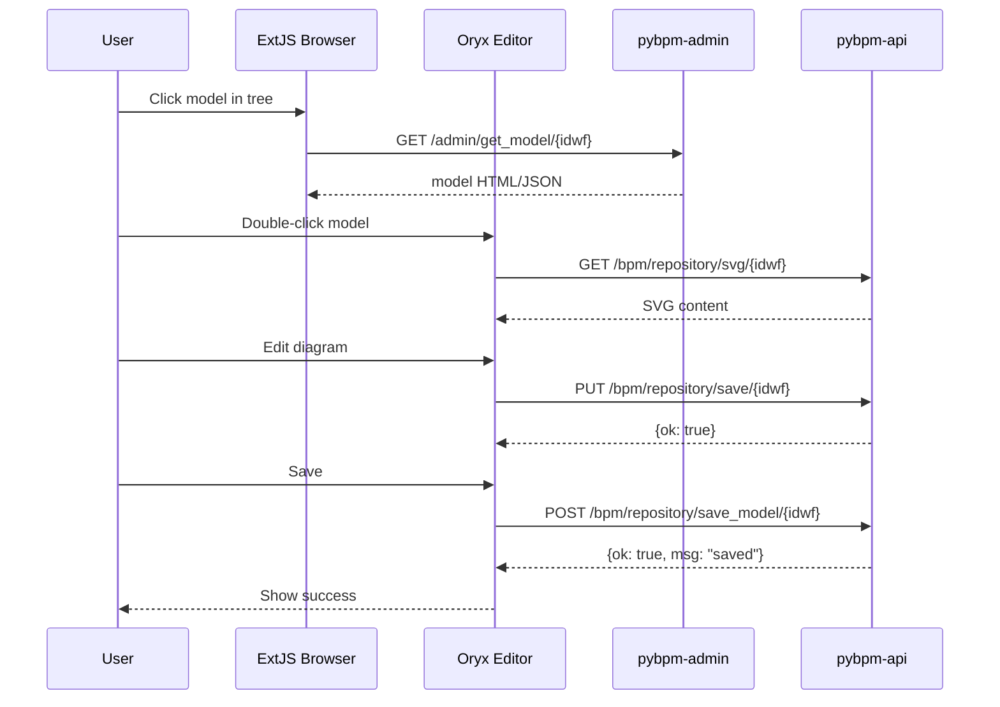

# PyBPM Admin

**Model Browser & BPMN Editor Admin Interface** — a FastAPI service that serves the admin interface for managing BPMN models, replacing the legacy PHP `Admin.php` controller.

## Architecture

### System Architecture

```mermaid
graph TB
    subgraph Browser["Browser Client"]
        EB[ExtJS Model Browser<br/>admin.html]
        OE[Oryx BPMN Editor<br/>Canvas + Stencil Panel]
    end
    
    subgraph Admin["pybpm-admin FastAPI (Port 8080)"]
        MW[Middleware<br/>CORS / NoCache / StaticFiles]
        AR[Admin API Router<br/>/admin/*]
        
        subgraph AdminRoutes["Admin Endpoints"]
            TRA[Tree API<br/>get_tree / get_tree2]
            CRUD[Model CRUD<br/>save/load/delete/dup]
            IMP[Import/Forms<br/>import_form / new_model_form]
        end
        
        subgraph Assets["Oryx Assets (static/)"]
            CSS[css/]
            JS[jscript/]
            IMG[images/]
            TYP[types/]
        end
        
        subgraph Templates["Jinja2 Templates"]
            TMPL[HTML form templates]
        end
        
        MW --> AR
        AR --> TRA
        AR --> CRUD
        AR --> IMP
        AR --> TMPL
        MW --> Assets
        Assets --> CSS
        Assets --> JS
        Assets --> IMG
        Assets --> TYP
    end
    
    subgraph Backend["pybpm-api FastAPI (Port 5000)"]
        MP[Model Persistence<br/>/bpm/repository/*]
        AU[Auth<br/>/auth/token]
        SM[Shape Metadata<br/>/bpm/repository/get_shapes]
    end
    
    EB -->|/admin/get_tree/json| TRA
    EB -->|/admin/tree/*| CRUD
    OE -->|/api/v1/bpm/repository/svg/{idwf}| MP
    OE -->|/api/v1/bpm/repository/save| MP
    OE -->|/api/v1/auth/token| AU
    OE -->|/api/v1/bpm/repository/get_shapes| SM
    
    style Admin fill:#e1f5fe
    style Backend fill:#f3e5f5
```

### Data Flow: Model Editing



### Admin API Endpoint Mapping

```mermaid
graph LR
    subgraph Legacy["Legacy PHP Admin.php"]
        L1[Index / Newb]
        L2[get_tree]
        L3[get_tree2]
        L4[tree action]
        L5[get_models]
        L6[get_model]
        L7[import_form]
        L8[new_model_form]
        L9[get_data]
        L10[model_move]
    end
    
    subgraph FastAPI["FastAPI Router (main.py)"]
        F1[GET /]
        F2[GET /admin/get_tree/json]
        F3[GET /admin/get_tree2/json]
        F4[POST/GET /admin/tree/{action}]
        F5[GET /admin/get_models]
        F6[GET /admin/get_model/{idwf}]
        F7[GET /admin/import_form]
        F8[GET /admin/new_model_form]
        F9[GET /admin/get_data/{idwf}/{idcase}]
        F10[POST /admin/model_move]
    end
    
    L1 --> F1
    L2 --> F2
    L3 --> F3
    L4 --> F4
    L5 --> F5
    L6 --> F6
    L7 --> F7
    L8 --> F8
    L9 --> F9
    L10 --> F10
```

## Tech Stack

| Layer | Technology |
|-------|-----------|
| Framework | FastAPI (sync + async mixed) |
| Templating | Jinja2 |
| Static Files | Starlette `StaticFiles` |
| Server | uvicorn |
| Config | dotenv + custom `Config` class |
| Editor | Oryx (ExtJS 4.x-based BPMN editor, legacy) |
| Package Manager | uv |

## Project Structure

```
pybpm-admin/
├── main.py                  # FastAPI app entry point + admin router
├── config.py                # Config class — reads env vars
├── admin.html               # Model Browser shell page (ExtJS viewport)
├── pyproject.toml           # Dependencies + ruff config
├── Dockerfile               # python:3.12-slim + uv
├── docker-compose.yml       # Admin service (port 8080)
├── Makefile                 # Dev shortcuts
├── .env / .env.example      # Environment configuration
├── .gitignore
├── AGENTS.md                # Architecture docs (legacy mapping, design decisions)
└── static/                  # Oryx editor assets (EXACT COPY — DO NOT MODIFY)
    ├── css/                 # browser.css, dna2.css, editor styles
    ├── jscript/             # ExtJS libs, Oryx core, model-utils, tokens
    ├── images/              # Icons, SVGs, loaders, palette images
    └── types/               # Type definitions for editor JS
```

## How It Works

### 1. Model Browser (ExtJS)

The browser loads `admin.html` which initializes an ExtJS viewport:

1. **Left panel**: `Ext.tree.TreePanel` populated from `/admin/get_tree/json`
2. **Right panel**: `Ext.grid.GridPanel` listing models in selected folder
3. **Toolbar**: Import, New Model, Refresh, Delete actions
4. **Selection**: Clicking a model loads its SVG into the Oryx editor

### 2. Oryx BPMN Editor

The editor is served as static assets from `static/` (exact copy from legacy DNA2BPM). It communicates directly with `pybpm-api` for model persistence:

```
Oryx Editor JS
    │
    ├── GET  /api/v1/bpm/repository/svg/{idwf}      → Load model SVG
    ├── PUT  /api/v1/bpm/repository/save/{idwf}      → Save edited model
    ├── POST /api/v1/auth/token                      → Authenticate
    ├── GET  /api/v1/bpm/repository/get_shapes/model/{idwf} → Shape metadata
    │
    ▼
pybpm-api (FastAPI)
```

The API base URL is set via `PYBPM_API_URL` in `.env`, injected into `admin.html` as `window.globals.apiUrl`.

### 3. Admin API Endpoints

The admin interface calls pybpm-admin's own `/admin/*` endpoints for:

- **Tree navigation**: `/admin/get_tree/json` — nested JSON tree for ExtJS TreePanel
- **Model CRUD**: `/admin/tree/*` — folder operations (create, read, update, destroy)
- **Model listing**: `/admin/get_models` — flat list with folder filter and sort
- **Model import**: `/admin/import_form` — form view for zip import
- **Model creation**: `/admin/new_model_form` — form with folder list
- **Model detail**: `/admin/get_model/{idwf}` — single model (JSON or HTML)

### 4. Authentication

User authentication is delegated to `pybpm-api`:

```python
# main.py: _authenticate_user()
async def _authenticate_user(username: str, password: str) -> dict | None:
    """Authenticate user via pybpm-api /auth/token endpoint."""
    async with httpx.AsyncClient() as client:
        response = await client.post(
            f"{Config.PYBPM_API_URL}/auth/token",
            data={"username": username, "password": password},
            headers={"Content-Type": "application/x-www-form-urlencoded"},
        )
    if response.status_code != 200:
        return None
    return response.json()
```

## Legacy Mapping: Admin.php → FastAPI

This service replaces the legacy PHP `Admin.php` controller. Each PHP method maps to a FastAPI endpoint:

| Legacy PHP Method | Route Pattern (FastAPI) | Purpose |
|---|---|---|
| `Index()` / `Newb()` | `GET /` | Model Browser UI — serves `admin.html` with ExtJS viewport |
| `get_tree()` | `GET /admin/get_tree/json` | Nested JSON tree of models for ExtJS TreePanel |
| `tree($action)` | `POST/GET /admin/tree/{action}` | CRUD on model folders (create, read, update, destroy) |
| `get_tree2()` | `GET /admin/get_tree2/json` | ExtJS-compatible flat tree with leaf/children format |
| `import_form()` | `GET /admin/import_form` | Import model form view / JSON data |
| `new_model_form()` | `GET /admin/new_model_form` | New model form with available folders list |
| `get_data($idwf, $idcase)` | `GET /admin/get_data/{idwf}/{idcase}` | Case data for a given model (requires engine) |
| `get_model($idwf, $mode)` | `GET /admin/get_model/{idwf}[?mode=json]` | Single model representation (JSON or HTML) |
| `get_models()` | `GET /admin/get_models[?folder=&order=]` | Flat list of all models with filter/sort |
| `model_move($from, $to)` | `POST /admin/model_move` | Move a model between folders |

Internal helpers (`convert_to_item`, `convert_to_ext`, `explodeTree`) are pure functions within the router — no separate endpoints.

## Configuration

| Variable | Default | Description |
|----------|---------|-------------|
| `PYBPM_API_URL` | `http://localhost:5000/api/v1` | Backend API URL |
| `APP_PORT` | `8080` | Server port |
| `ENVIRONMENT` | `production` | development/production/testing |
| `DEBUG` | `false` | Enable debug mode |

## Development

```bash
# Install dependencies
uv sync

# Set PYBPM_API_URL in .env
# e.g., PYBPM_API_URL=http://localhost:5000/api/v1

# Run with hot-reload
uv run uvicorn main:app --reload --port 8080

# Visit: http://localhost:8080/
```

### Testing

```bash
# Run tests
uv run pytest

# Lint & format
uv run ruff check --fix .
uv run ruff format .
```

### Docker

```bash
# Start admin service (requires pybpm-api running)
docker compose up -d

# Visit: http://localhost:8080/
```

## Important Notes

1. **Do not modify `static/`** — it is an exact copy from legacy and must stay unchanged.
2. **The Oryx editor code was written for ExtJS 4.x** and older browser APIs. It runs as-is in modern browsers — no transpilation or bundling needed.
3. **pybpm-admin is independent of pybpm-api** — it does not proxy requests to it. It serves static assets and admin API endpoints. The Oryx editor communicates with pybpm-api directly for model persistence.
4. **Configuration follows the same pattern as pybpm-api**: `config.py` imports dotenv and exposes a `Config` class with class-level attributes matching env var names.
5. **New editor features** go into `admin.html` without touching the `static/` directory.
6. **All git operations** run from within `pybpm-admin/` — never in the parent workspace folder.
